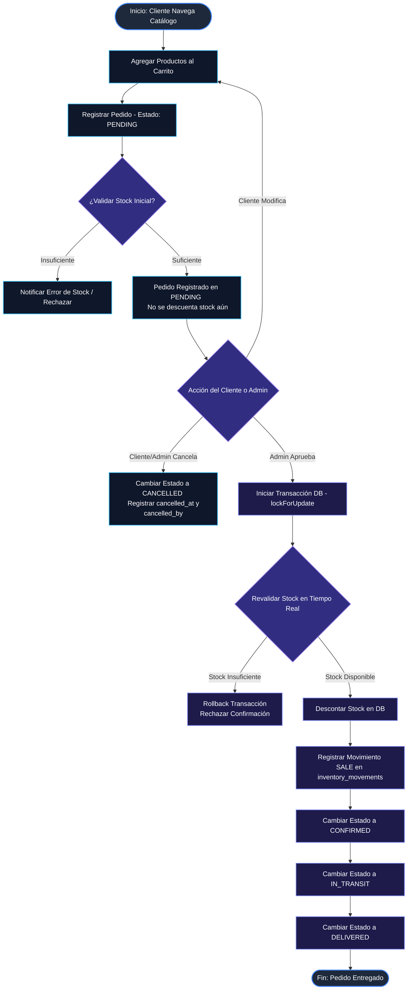
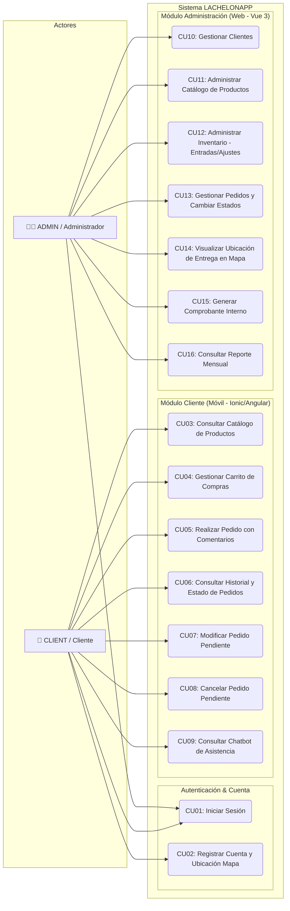

# Flujo del Sistema y Casos de Uso — La Chelona App

Este documento describe de manera detallada el flujo de comunicación, el ciclo de vida del proceso de pedidos y la especificación formal de Casos de Uso de **La Chelona App**, con base en la Guía Base de Arquitectura y Especificación Técnica del proyecto.

---

## 1. Diagramas de Flujo del Sistema

### 1.1 Flujo Principal: Ciclo de Vida del Pedido y Control de Inventario

El siguiente diagrama ilustra la secuencia completa que sigue un pedido desde su creación por parte del cliente en la aplicación móvil, pasando por la validación del inventario en tiempo real con transacciones atómicas de Laravel (`lockForUpdate()`), hasta la entrega final o cancelación.

#### Reglas de Negocio en el Flujo:
1. **Estado `PENDING`:** Al crearse el pedido, únicamente se valida que exista stock pero **NO** se descuenta de la base de datos. En este estado, el cliente puede editar cantidades/productos o cancelar el pedido.
2. **Estado `CONFIRMED`:** Solo el administrador puede realizar esta transición. Se ejecuta mediante una transacción de base de datos con bloqueo optimista/pesimista (`lockForUpdate()`), descontando el stock e insertando el registro tipo `SALE` en `inventory_movements`.
3. **Estado `CANCELLED`:** Solo se pueden cancelar pedidos en estado `PENDING`. No requiere reversión de stock ya que no fue descontado previamente.

---

## 2. Diagramas de Casos de Uso (UML)

El sistema cuenta con dos actores principales definidos por su rol:
* **CLIENT:** Cliente del negocio (Uso desde la app móvil Ionic 9 + Angular).
* **ADMIN:** Dueño o encargado de la distribuidora (Uso desde el panel web Vue 3).

### 2.1 Diagrama de Casos de Uso General

---

## 3. Matriz de Mapeo: Casos de Uso vs. Historias de Usuario

| ID Caso de Uso | Historia de Usuario | Descripción Funcional | Rol Principal | Sprint Asignado |
| :--- | :--- | :--- | :--- | :--- |
| **CU01** | HU01 / HU02 | Autenticación de usuarios mediante tokens Bearer (`Laravel Sanctum`). | CLIENT / ADMIN | Sprint 1 |
| **CU02** | HU18 | Registro de cliente con selección de coordenadas (`latitud`, `longitud`) en mapa. | CLIENT | Sprint 2 |
| **CU03** | HU03 | Consulta de productos activos ordenados por categoría en catálogo mayorista. | CLIENT | Sprint 1 |
| **CU04** | HU04 | Gestión del carrito de compras (fardos/cajas) con validaciones de límite de stock. | CLIENT | Sprint 2 |
| **CU05** | HU05 / HU16 | Realización de pedido en estado `PENDING` con comentarios generales e individuales. | CLIENT | Sprint 2 |
| **CU06** | HU06 / HU07 | Visualización del historial propio y seguimiento de estados (`PENDING`, `CONFIRMED`, etc.). | CLIENT | Sprint 2 |
| **CU07** | HU08 | Edición de cantidades o productos únicamente si el pedido está en `PENDING`. | CLIENT | Sprint 2 |
| **CU08** | HU09 | Cancelación de pedido en estado `PENDING`, guardando autor y fecha. | CLIENT / ADMIN | Sprint 2 |
| **CU09** | HU17 | Consulta a Chatbot interactivo de asistencia para pedidos y productos. | CLIENT | Sprint 4 |
| **CU10** | HU10 | Administración completa de la cartera de clientes y activación/desactivación de accesos. | ADMIN | Sprint 3 |
| **CU11** | HU11 | Gestión de productos, precios, empaques mayoristas y stock mínimo. | ADMIN | Sprint 3 |
| **CU12** | HU12 | Registro manual de entradas de mercancía (`ENTRY`) y ajustes de stock (`ADJUSTMENT`). | ADMIN | Sprint 3 |
| **CU13** | HU13 | Transición secuencial de estados del pedido y descuento atómico de inventario en `CONFIRMED`. | ADMIN | Sprint 3 |
| **CU14** | HU13 / HU18 | Visualización geográfica de la dirección de entrega de cada pedido sobre un mapa integrado. | ADMIN | Sprint 3 |
| **CU15** | HU14 | Emisión de comprobantes internos de venta inmutables asociados al pedido. | ADMIN | Sprint 3 |
| **CU16** | HU15 | Generación de métricas mensuales de ventas, productos más vendidos y cliente top. | ADMIN | Sprint 3 |

---

