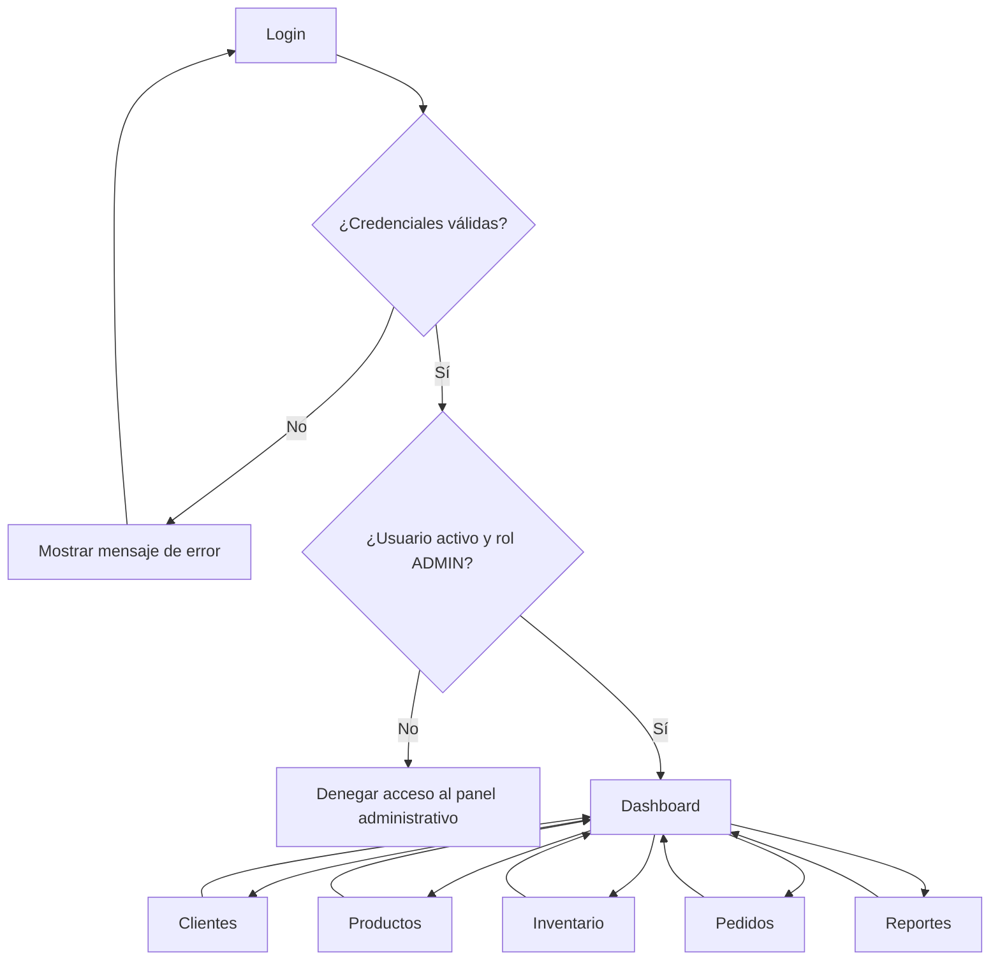

# Navegación del panel administrativo — La Chelona

## 1. Objetivo

Documentar el flujo de navegación del panel administrativo de La Chelona, desde el inicio de sesión hasta las secciones principales del Dashboard.

Esta documentación describe la navegación prevista para el administrador. No significa que todas las pantallas ya estén implementadas.

## 2. Flujo general de navegación

> Nota: el diagrama representa el flujo previsto. La guía define el inicio de sesión del administrador y las funciones administrativas; la navegación visual entre pantallas deberá implementarse en el frontend.

## 3. Descripción de las pantallas

### 3.1 Login

Es la pantalla de entrada al sistema. El administrador introduce su nombre de usuario y contraseña.

- La API prevista para iniciar sesión es `POST /api/auth/login`.
- Si las credenciales son válidas, la respuesta incluye un token y los datos del usuario.
- Solo los usuarios activos con rol `ADMIN` deben acceder al panel administrativo.
- Si las credenciales son incorrectas o el usuario no tiene permisos, se debe mostrar un mensaje y no permitir el acceso al Dashboard.

**Referencia funcional:** HU02 — Como administrador quiero iniciar sesión para acceder al panel administrativo.

### 3.2 Dashboard

Es la pantalla principal después de iniciar sesión correctamente. Desde aquí el administrador puede dirigirse a las secciones de gestión.

El Dashboard funciona como punto de entrada a:

- Clientes
- Productos
- Inventario
- Pedidos
- Reportes

La guía del proyecto no especifica indicadores o tarjetas concretas para el Dashboard, por lo que esos elementos quedan fuera de esta documentación.

### 3.3 Clientes

Permite al administrador gestionar los clientes registrados en el sistema.

Funciones contempladas en la guía:

- Consultar y gestionar clientes registrados.

**Referencia funcional:** HU10 — Como administrador quiero gestionar clientes registrados.

### 3.4 Productos

Permite administrar los productos disponibles en el catálogo.

La información de productos definida en la guía incluye código, nombre, categoría, presentación, tipo de empaque, unidades por empaque, precio de venta, existencia, stock mínimo e imagen opcional.

**Referencia funcional:** HU11 — Como administrador quiero administrar productos.

### 3.5 Inventario

Permite administrar las existencias de los productos y mantener el registro de movimientos de inventario.

La guía contempla movimientos de tipo entrada, venta y ajuste. Estos movimientos permiten llevar la trazabilidad de los cambios en las existencias.

**Referencia funcional:** HU12 — Como administrador quiero administrar inventario.

### 3.6 Pedidos

Permite al administrador gestionar los pedidos realizados por los clientes y trabajar con su flujo de estados.

La guía contempla estados como pendiente, confirmado, en tránsito, entregado y cancelado. También contempla la generación de un comprobante interno asociado al pedido.

**Referencias funcionales:**
- HU13 — Como administrador quiero gestionar los pedidos.
- HU14 — Como administrador quiero generar un comprobante interno.

### 3.7 Reportes

Permite consultar el reporte mensual previsto para la gestión administrativa.

La guía menciona el reporte mensual y considera la fecha de entrega de los pedidos para apoyar el cálculo de métricas mensuales. Los indicadores específicos del reporte no se detallan aquí porque deben definirse según el alcance acordado del proyecto.

**Referencia funcional:** HU15 — Como administrador quiero consultar un reporte mensual.

## 4. Reglas generales de navegación

1. El usuario debe iniciar sesión antes de entrar al panel administrativo.
2. El acceso al panel administrativo corresponde al rol `ADMIN`.
3. Si el inicio de sesión falla, el usuario permanece en Login y recibe un mensaje de error.
4. Después de autenticarse correctamente, el administrador puede acceder a las cinco secciones desde el Dashboard.
5. Cada sección debe ofrecer una forma de regresar al Dashboard o usar la navegación principal.
6. La navegación no reemplaza la validación de permisos en el backend; las operaciones administrativas deben estar protegidas también en la API.

## 5. Resumen del flujo

| Paso | Pantalla o acción | Descripción |
|---|---|---|
| 1 | Login | El administrador ingresa sus credenciales. |
| 2 | Validación | Se verifican las credenciales, el estado de la cuenta y el rol. |
| 3 | Dashboard | Se muestra el punto principal de navegación administrativa. |
| 4 | Clientes | Gestión de clientes registrados. |
| 5 | Productos | Administración del catálogo de productos. |
| 6 | Inventario | Gestión de existencias y movimientos. |
| 7 | Pedidos | Gestión de pedidos y comprobantes internos. |
| 8 | Reportes | Consulta del reporte mensual. |

## 6. Tecnologías relacionadas según la guía

- **Backend:** Laravel, mediante una API REST.
- **Panel administrativo:** Vue 3.
- **Autenticación:** Laravel Sanctum con tokens Bearer.
- **Endpoint de inicio de sesión:** `POST /api/auth/login`.

La guía define estas tecnologías como parte de la arquitectura del proyecto. Esta documentación se limita a describir la navegación administrativa y no implementa las pantallas ni los endpoints.

## 7. Historias de usuario relacionadas

| ID | Historia de usuario |
|---|---|
| HU02 | El administrador inicia sesión para acceder al panel administrativo. |
| HU10 | El administrador gestiona clientes registrados. |
| HU11 | El administrador administra productos. |
| HU12 | El administrador administra inventario. |
| HU13 | El administrador gestiona pedidos. |
| HU14 | El administrador genera un comprobante interno. |
| HU15 | El administrador consulta un reporte mensual. |

## 8. Alcance de este documento

Este archivo documenta el flujo de navegación solicitado para el panel administrativo. No incluye el diseño visual definitivo, el código de las vistas, las rutas concretas del frontend ni los indicadores detallados del Dashboard, ya que la guía base no los especifica.
