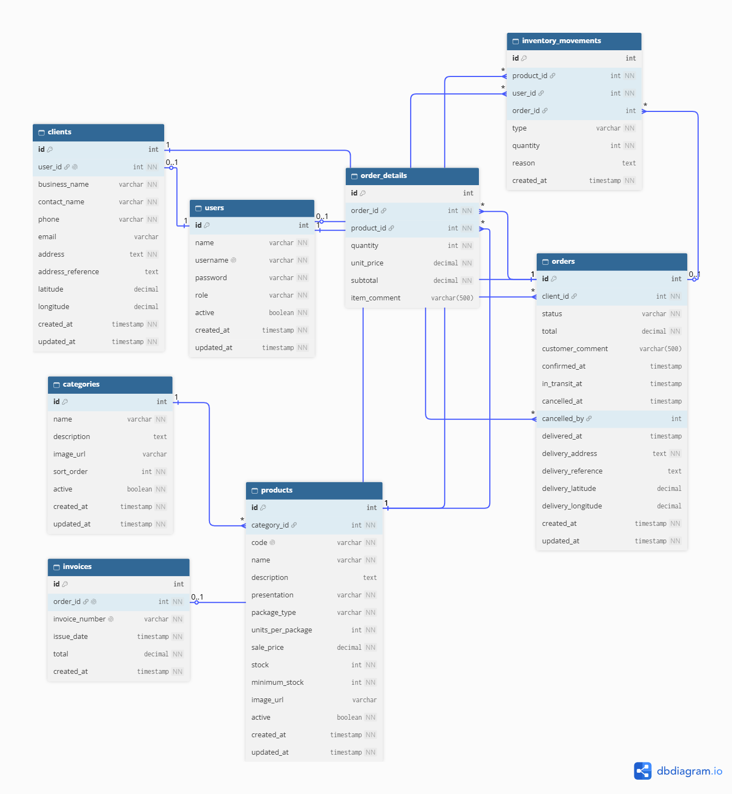

# Diagrama Entidad-Relación — LaChelonApp

El siguiente diagrama representa el modelo entidad-relación inicial del sistema.

## Entidades principales

- users
- clients
- categories
- products
- orders
- order_details
- invoices
- inventory_movements

## Relaciones principales

- Users 1 -> 0..1 Clients
- Clients 1 -> N Orders
- Categories 1 -> N Products
- Orders 1 -> N OrderDetails
- Products 1 -> N OrderDetails
- Orders 1 -> 0..1 Invoices
- Products 1 -> N InventoryMovements
- Users 1 -> N InventoryMovements
- Orders 1 -> 0..N InventoryMovements