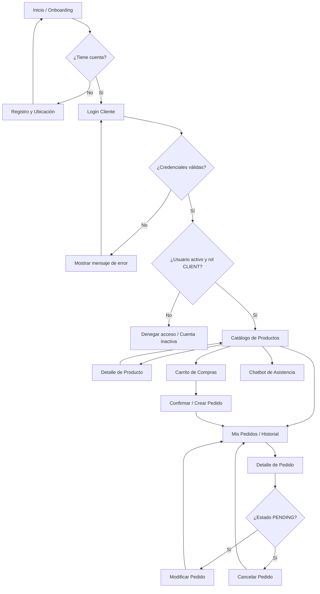

Aquí tienes la documentación completa para **`user-navigation.md`** redactada en Markdown, manteniendo exactamente la misma estructura, tono técnico y estilo que `admin-navigation.md` y alineada con la guía base de arquitectura del proyecto **LACHELONAPP**.

---

# Navegación de la aplicación cliente (Móvil) — La Chelona

## 1. Objetivo

Documentar el flujo de navegación de la aplicación móvil de clientes de La Chelona, desde el registro e inicio de sesión hasta las secciones principales del catálogo, carrito, gestión de pedidos y soporte.

Esta documentación describe la navegación prevista para los clientes comerciales (tiendas/negocios). No significa que todas las pantallas ya estén implementadas en el frontend.

## 2. Flujo general de navegación

> **Nota:** El diagrama representa el flujo previsto para la aplicación móvil (Ionic 9 + Angular). La navegación entre vistas y componentes se gestionará a través de las rutas móviles del cliente.
> 
> 

## 3. Descripción de las pantallas

### 3.1 Registro y Ubicación de Entrega

Permite a los nuevos clientes registrar su negocio en la plataforma y definir la ubicación donde se entregarán los pedidos.

* **Datos de cuenta:** Nombre completo/contacto, nombre de usuario, contraseña, teléfono, correo electrónico (opcional), nombre del negocio y dirección escrita.

* **Ubicación en mapa:** Selección interactiva del punto de entrega (latitud y longitud) e ingreso de un punto de referencia.

* **API prevista:** `POST /api/auth/register`.

* Al registrarse, se crean los registros correspondientes en las entidades de usuarios y clientes.

**Referencia funcional:** HU18 — Como cliente quiero registrar mi cuenta y marcar mi ubicación de entrega en un mapa para indicar dónde deben entregar mis pedidos.

---

### 3.2 Login Cliente

Pantalla de entrada para los clientes existentes.

* **API prevista:** `POST /api/auth/login`.

* Si las credenciales son válidas, la API retorna el token Bearer y los datos del usuario.

* Solo pueden ingresar usuarios activos (`active = true`) con rol `CLIENT`.

* Si la autenticación falla o el usuario no tiene rol de cliente, se muestra un mensaje de error claro.

**Referencia funcional:** HU01 — Como cliente quiero iniciar sesión para acceder a mi cuenta.

---

### 3.3 Catálogo de Productos

Pantalla principal donde el cliente navega por las categorías y productos disponibles para compra mayorista.

* Muestra únicamente productos activos en el sistema (`active = true`).

* Muestra el nombre del producto, categoría, presentación (ej. 600 ml), tipo de empaque (FARDO/CAJA), unidades por empaque, precio de venta por empaque y disponibilidad de stock.

* **API prevista:** `GET /api/categories` y `GET /api/products`.

**Referencia funcional:** HU03 — Como cliente quiero consultar los productos disponibles para realizar pedidos.

---

### 3.4 Carrito de Compras

Sección interactiva donde el cliente prepara su pedido antes de enviarlo.

* Permite agregar productos activos, modificar cantidades (en fardos/cajas) y eliminar ítems.

* Valida que la cantidad solicitada sea mayor a cero y no supere la existencia/stock disponible.

* Calcula subtotales por producto y el total general de la compra.

* Permite agregar observaciones específicas por producto (ej. "Preferiblemente heladas") y una observación general del pedido (ej. "Entregar después de las 2 PM").

**Referencias funcionales:**

* HU04 — Como cliente quiero agregar productos a un carrito para preparar mi pedido.

* HU16 — Como cliente quiero agregar observaciones a mi pedido o a productos específicos.

---

### 3.5 Creación / Confirmación de Pedido

Proceso en el cual se envía la orden de compra al sistema.

* **API prevista:** `POST /api/orders`.

* Se guardan los productos, cantidades, subtotales, observaciones y la copia histórica de los precios vigentes y la dirección/ubicación del cliente.

* El pedido inicia automáticamente en estado `PENDING` (Pendiente).

* **Nota de backend:** En esta etapa se revalida el stock pero aún no se descuenta de inventario sino hasta que el administrador confirma el pedido.

**Referencia funcional:** HU05 — Como cliente quiero realizar un pedido para solicitar los productos seleccionados.

---

### 3.6 Mis Pedidos (Historial y Estado)

Vista donde el cliente consulta el listado de sus compras pasadas y vigentes.

* Muestra únicamente los pedidos del cliente autenticado.

* Muestra la fecha de creación, número de pedido, total y el estado operativo del flujo:

* **Pendiente** (`PENDING`)

* **Confirmado** (`CONFIRMED`)

* **En camino** (`IN_TRANSIT`)

* **Entregado** (`DELIVERED`)

* **Cancelado** (`CANCELLED`)

* **APIs previstas:** `GET /api/orders/my` y `GET /api/orders/{id}`.

**Referencias funcionales:**

* HU06 — Como cliente quiero consultar mi historial de pedidos.

* HU07 — Como cliente quiero consultar el estado de mis pedidos.

---

### 3.7 Modificación y Cancelación de Pedidos

Permite al cliente gestionar o anular solicitudes aún no procesadas.

* **Modificación:** Solo aplica para pedidos propios en estado `PENDING`. Permite cambiar cantidades o ítems revalidando existencias y recalculando el total.

* **Cancelación:** Solo aplica para pedidos en estado `PENDING`. Cambia el estado a `CANCELLED` y guarda la fecha/hora y usuario que canceló.

* Una vez el pedido pasa a `CONFIRMED` por el administrador, el cliente ya no puede modificarlo ni cancelarlo.

* **APIs previstas:** `PUT /api/orders/{id}` y `PATCH /api/orders/{id}/cancel`.

**Referencias funcionales:**

* HU08 — Como cliente quiero modificar un pedido pendiente.

* HU09 — Como cliente quiero cancelar un pedido pendiente.

---

### 3.8 Chatbot de Asistencia (Módulo opcional / Sprint 4)

Asistente conversacional dentro de la aplicación móvil.

* Permite resolver dudas frecuentes, brindar ayuda para localizar productos en el catálogo, explicar las etapas del pedido y consultar el estado de un pedido en curso.

* En su etapa inicial opera como un canal informativo de consulta y no realiza modificaciones directas sobre los pedidos.

**Referencia funcional:** HU17 — Como cliente quiero consultar un chatbot de asistencia para resolver dudas sobre productos y pedidos.

---

## 4. Reglas generales de navegación

1. El cliente debe registrarse o iniciar sesión antes de realizar compras.

2. Los precios y unidades se expresan en empaques mayoristas (fardos o cajas cerradas).

3. El cliente solo tiene visibilidad sobre sus propios pedidos e información de su negocio.

4. La modificación o cancelación de un pedido está restringida estrictamente al estado `PENDING`.

5. Las observaciones agregadas al pedido son notas aclaratorias y en ningún caso sustituyen la selección formal del producto y su presentación.

6. Las validaciones de stock, precios y estados se aplican directamente en la API REST (Laravel) independientemente de la interfaz.

---

## 5. Resumen del flujo

| Paso | Pantalla o acción | Descripción |
| --- | --- | --- |
| 1 | Registro / Login | El cliente se registra con su ubicación en mapa o ingresa con sus credenciales.

 |
| 2 | Catálogo | Consulta de categorías y catálogo de productos activos.

 |
| 3 | Carrito | Selección de productos, cantidades en fardos/cajas e ingreso de observaciones.

 |
| 4 | Confirmación | Envío del pedido; el sistema genera el registro en estado Pendiente (`PENDING`).

 |
| 5 | Mis Pedidos | Seguimiento en tiempo real del estado de sus solicitudes.

 |
| 6 | Modificación / Anulación | Ajustes o cancelación opcional mientras el pedido permanezca `PENDING`.

 |
| 7 | Asistencia (Chatbot) | Consulta interactiva sobre catálogo, dudas generales o estados.

 |

---

## 6. Tecnologías relacionadas según la guía

* **Backend:** Laravel 13 REST API.

* **Aplicación cliente:** Ionic 9 + Angular.

* **Autenticación:** Laravel Sanctum con tokens Bearer.

* **Base de datos:** PostgreSQL alojado en Supabase.

---

## 7. Historias de usuario relacionadas

| ID | Historia de usuario |
| --- | --- |
| HU01 | El cliente inicia sesión para acceder a su cuenta.

 |
| HU03 | El cliente consulta los productos disponibles para realizar pedidos.

 |
| HU04 | El cliente agrega productos a un carrito para preparar su pedido.

 |
| HU05 | El cliente realiza un pedido para solicitar los productos seleccionados.

 |
| HU06 | El cliente consulta su historial de pedidos.

 |
| HU07 | El cliente consulta el estado de sus pedidos.

 |
| HU08 | El cliente modifica un pedido pendiente.

 |
| HU09 | El cliente cancela un pedido pendiente.

 |
| HU16 | El cliente agrega observaciones a su pedido o a productos específicos.

 |
| HU17 | El cliente consulta un chatbot de asistencia para resolver dudas sobre productos y pedidos.

 |
| HU18 | El cliente registra su cuenta y marca su ubicación de entrega en un mapa para indicar dónde deben entregar sus pedidos.

 |

---

## 8. Alcance de este documento

Este archivo documenta el flujo de navegación del usuario cliente para la aplicación móvil. No incluye el diseño de pantallas definitivas, maqueta en Figma, código de componentes Angular/Ionic ni rutas internas de la aplicación, ya que están sujetas a la implementación del desarrollo.